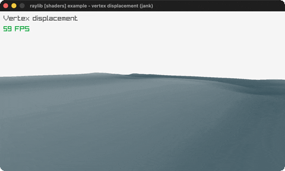

# vertex-displacement

A plane mesh riding Perlin-noise waves in the vertex shader.

Category: shaders. Controls: WASD + mouse look, ESC.

Ported from raylib's `examples/shaders/shaders_vertex_displacement.c`.



## Run it

```sh
cd vertex-displacement && bb run   # from this demo (or lein run --disable-sandbox)
bb vertex-displacement             # from the repo root
```

It loads files from the vendored raylib checkout (`jank-raylib-sys/raylib/examples/shaders/resources/`) by a path relative to this directory, so run it from here. The repo's `jank-raylib-sys/raylib` submodule has to be checked out.

## About

raylib [shaders] example - vertex displacement, ported to jank.

A 50x50 plane mesh whose VERTICES ride animated waves: the vertex
shader displaces them by scrolling Perlin-noise lookups, the
fragment shader colors by height (water / sand / grass). Free
camera: WASD move, mouse look. ESC quits.
Based on raylib/examples/shaders/shaders_vertex_displacement.c

jank-native notes:
- The Perlin noise texture binds to sampler slot 1 ONCE before the
  loop through raw rlgl calls (rlEnableShader + rlActiveTextureSlot
  + rlEnableTexture + rlSetUniformSampler); the .-id field reads
  feed the rlgl calls directly.
- GenImagePerlinNoise is a plain call; the material shader write is
  models.jank; the time FLOAT uniform rides the
  rlights setter toolbox (location hoisted out of the loop,
  unlike the C's per-frame lookup).
