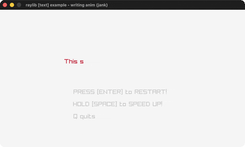

# writing-anim

A message types itself out.

Category: text. Controls: SPACE speed up · ENTER restart · Q quit.

Ported from raylib's `examples/text/text_writing_anim.c`.



## Run it

```sh
cd writing-anim && bb run   # from this demo (or lein run --disable-sandbox)
bb writing-anim             # from the repo root
```

## About

raylib [text] example - writing anim, ported to jank.

A message types itself out one character per 10 frames. Hold SPACE to
speed up, ENTER restarts, Q quits.
Based on raylib/examples/text/text_writing_anim.c
(jank-native: TextSubtext becomes subs with the end index clamped to
the message length.)
