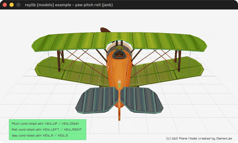

# yaw-pitch-roll

Fly a WWI plane through pitch/yaw/roll, easing level.

Category: models. Controls: UP/DOWN pitch, LEFT/RIGHT roll, A/S yaw, ESC.

Ported from raylib's `examples/models/models_yaw_pitch_roll.c`.



## Run it

```sh
cd yaw-pitch-roll && bb run   # from this demo (or lein run --disable-sandbox)
bb yaw-pitch-roll             # from the repo root
```

It loads files from the vendored raylib checkout (`jank-raylib-sys/raylib/examples/models/resources/`) by a path relative to this directory, so run it from here. The repo's `jank-raylib-sys/raylib` submodule has to be checked out.

## About

raylib [models] example - yaw pitch roll, ported to jank.

Fly a WWI plane model through its three rotation axes: UP/DOWN
pitch, LEFT/RIGHT roll, A/S yaw - each angle eases back toward
level when its keys are released. ESC quits.
Based on raylib/examples/models/models_yaw_pitch_roll.c

jank-native notes:
- Pitch/yaw/roll thread as jank reals with the C's ease-back-to-
  level decay branches as conds; the transform is an absolute
  cpp/= of MatrixRotateXYZ fed DEG2RAD-scaled angles.
- OBJ model + material texture write are proven ground.
